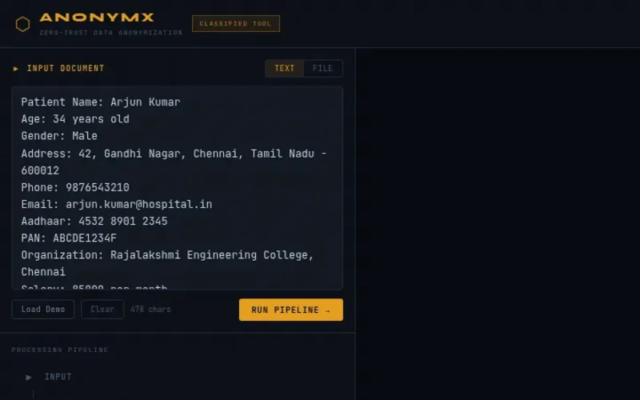
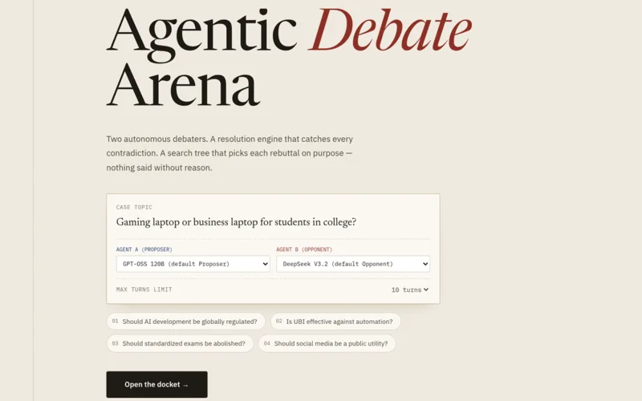
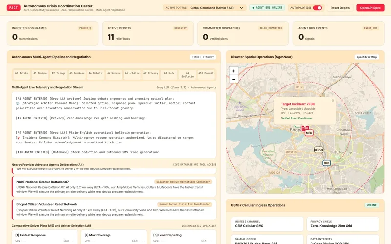
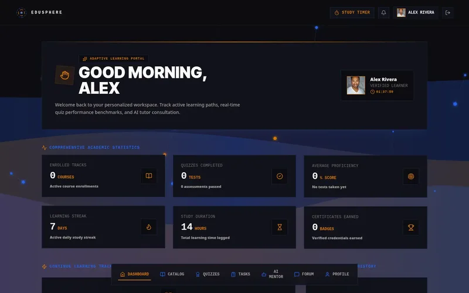

# Adhithya S

CSE student in Chennai. I build software, and I take hardware apart to see how it works.

 

- Interned in Chennai Metro Rail's IT department in June 2026, rebuilding their commuter chatbot so fares and routes come from real data instead of the language model.
- Building privacy and multi-agent tools: AnonymX, PACT and the Agentic Debate Arena.
- Daily driver is CachyOS on a Zenbook 14 OLED, tuned more than it probably needs.
- Currently bringing an old Toshiba Satellite C630 back to life.

## Things I've built

<table>
<tr>
<td width="50%" valign="top">

**[AnonymX](https://github.com/adhiprojs/ANONYMX)** 
Encryption leaves a key to steal, so AnonymX changes the data instead: "22 yrs" becomes "20–25" until nobody can be singled out. Runs fully offline.

`Rust` `Tauri` `spaCy` `k-anonymity`
</td>
<td width="50%" valign="top">

**[Agentic Debate Arena](https://github.com/adhiprojs/Agentic-Debate-Arena-with-MCTS)** 
Two AI agents debate, but the language models never pick the winner. Monte Carlo tree search chooses each argument and logic checks every refutation.

`Python` `FastAPI` `React` `MCTS`
</td>
</tr>
<tr>
<td width="50%" valign="top">

**[PACT](https://github.com/adhiprojs/PACT)** 
Disaster coordination for when only 2G SMS gets through. Headcount, injuries, supplies and GPS fit into 35 characters, and any Android phone with Termux can be the gateway.

`Python` `Kotlin` `Android` `Multi-agent`
</td>
<td width="50%" valign="top">

**[EduSphere](https://github.com/adhiprojs/Edusphere)** 
Serverless learning portal on Azure with an AI mentor. Once it worked we attacked it ourselves and fixed stored XSS, unguarded write APIs and token-bill abuse.

`JavaScript` `Azure` `Cosmos DB` `Entra ID`
</td>
</tr>
</table>

## What I work with

Also: spaCy, Monte Carlo tree search, LLM APIs (Groq, Gemini, OpenRouter, NVIDIA NIM), Cosmos DB, Entra ID, Termux, fish.

## Activity

<picture>
  <source media="(prefers-color-scheme: dark)" srcset="https://raw.githubusercontent.com/adhiprojs/adhiprojs/output/contributions-dark.svg">
  <source media="(prefers-color-scheme: light)" srcset="https://raw.githubusercontent.com/adhiprojs/adhiprojs/output/contributions-light.svg">
  
</picture>
